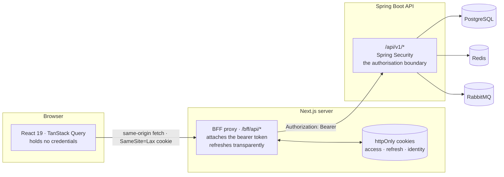

<div align="center">

# SentinelPay Console

**Operator front end for the SentinelPay payment platform** — submit and trace payments, triage fraud outcomes, and recover stranded payment events.

[](https://nextjs.org)
[](https://react.dev)
[](https://www.typescriptlang.org)
[](https://tailwindcss.com)
[](https://tanstack.com/query)
[](https://pnpm.io)

</div>

---

## Contents

- [What this is](#what-this-is)
- [Highlights](#highlights)
- [Architecture](#architecture)
- [Tech stack](#tech-stack)
- [Quick start](#quick-start)
- [Configuration](#configuration)
- [Project structure](#project-structure)
- [API integration](#api-integration)
- [Engineering notes](#engineering-notes)
- [Known limitations](#known-limitations)

---

## What this is

The browser-facing half of [SentinelPay](https://github.com/janith-codes/sentinel-pay), a Java 21 / Spring Boot payment gateway with AI-assisted fraud detection. The backend lives in its own repository; this one holds the console alone.

It is a role-aware operator tool rather than a demo: an **account holder** sees their own account and ledger, while an **administrator** additionally gets platform-wide aggregation, account provisioning and the transactional-outbox recovery screen.

Every figure on screen is read from the API. Where the backend genuinely cannot supply something, the interface says so in place of the number — a dashboard that looks complete and quietly misleads is worse than one that admits a gap.

## Highlights

| | |
| --- | --- |
| 🔒 **Tokens never reach the browser** | A backend-for-frontend proxy holds the JWT and refresh token in httpOnly cookies. Page scripts cannot read them, so an XSS flaw cannot steal the session. |
| 🔁 **Race-safe token refresh** | The backend revokes a session if a refresh token is replayed. Exchanges are single-flighted so concurrent 401s can't log the user out of their own dashboard. |
| 🧾 **Decimal-safe money** | Amounts stay `string` from Postgres to the DOM. No ledger value is ever parsed into an IEEE-754 double. |
| ♿ **Accessible by construction** | Real `<table>` semantics, status never carried by colour alone, `inert` behind the mobile drawer, focus returned on dismiss. |
| 📊 **Validated chart palette** | Colours checked by script for CVD separation and contrast in both themes — not chosen by eye. |
| 🔗 **Shareable deep links** | Payment detail and filtered ledger views are real URLs that survive a refresh and paste into a ticket. |

## Architecture

The browser never calls Spring Boot. Requests go to this Next.js server, which attaches the access token and forwards them upstream.



<details>
<summary><b>Why a proxy, and not direct calls</b></summary>

<br>

Two independent reasons, either sufficient on its own.

**1. The backend has no CORS configuration.** `SecurityConfig` disables CSRF and goes stateless, but never calls `.cors(...)`, and no `CorsConfigurationSource` bean exists anywhere in the API. A browser on `localhost:3000` therefore cannot call `localhost:8080` at all. The choice was to modify a backend module or to make this server the browser's only origin.

**2. It is what keeps the credentials out of reach.** The backend issues a 15-minute JWT and a 30-day refresh token. Neither is returned to client JavaScript — `POST /bff/auth/login` answers with `{ username, roles }` and nothing else. A 30-day refresh token in `localStorage` would turn any XSS anywhere in the app into a 30-day account compromise.

**The costs, stated plainly:**

- Cookies ride along automatically, which is a CSRF surface that bearer headers are not. Paid for twice: `SameSite=Lax`, which withholds the cookie from cross-site POSTs, and an explicit `Origin` check on every mutating proxy request.
- Every API call takes an extra hop.
- The identity cookie decides which navigation to draw and nothing else. Every authorisation decision is made by Spring Security against the signed JWT; forging it buys a misleading menu.

</details>

<details>
<summary><b>Why token refresh is single-flighted</b></summary>

<br>

The backend's refresh tokens are single use and rotated, and presenting a **spent** one is treated as evidence of compromise that revokes the entire session.

A dashboard fires several queries at once. When the access token expires they all receive 401 together — and if each independently exchanged the refresh token, the first would succeed and the rest would present a spent token, logging the user out of everything simply for loading a page.

So every exchange goes through one in-flight map keyed by the token being spent (`src/lib/auth/token-exchange.ts`). Resolved results stay cached briefly afterwards, because a request whose headers were assembled before the new `Set-Cookie` landed still arrives carrying the old token.

> **Verified:** six concurrent requests against an expired access cookie produced exactly **one** refresh exchange upstream, and the session survived.

</details>

## Tech stack

| Concern | Choice |
| --- | --- |
| Framework | Next.js 16 (App Router), React 19 |
| Language | TypeScript 5, `strict` |
| Styling | Tailwind CSS v4, design tokens in `globals.css` |
| Components | shadcn/ui on Radix primitives |
| Server state | TanStack Query v5 |
| Forms | React Hook Form + Zod |
| Charts | Recharts |
| Icons | Lucide |
| Package manager | pnpm |

## Quick start

### Prerequisites

- **Node.js 22+** and **pnpm 11+**
- The [SentinelPay API](https://github.com/janith-codes/sentinel-pay) cloned as a sibling directory, plus Docker for its Postgres, Redis and RabbitMQ

### 1 · Start the backend and its infrastructure

From the **API repository**:

```bash
docker compose up -d postgres redis rabbitmq
```

```bash
./mvnw -DskipTests package && java -jar sentinel-pay-api/target/sentinel-pay-api-1.0.0-SNAPSHOT-exec.jar
```

> [!TIP]
> A Spring Boot executable jar is read lazily while the process runs. Rebuilding it underneath a running instance makes not-yet-loaded classes fail with `NoClassDefFoundError`. Restart the process — it is not a code fault.

### 2 · Start the console

From **this repository**:

```bash
cp .env.example .env.local && pnpm install && pnpm dev
```

The console is served at <http://localhost:3000>.

### 3 · Create a user to sign in as

The API's `V2__Create_users_and_roles.sql` deliberately ships no credentials, so a fresh database has nobody to sign in as. Insert an identity with a BCrypt password hash:

```bash
docker exec -it sentinel-pay-db psql -U sentinel -d sentinelpay
```

An **administrator** needs no linked account. An **account holder** needs one, and `users.account_id` is the link.

### Scripts

| Command | What it does |
| --- | --- |
| `pnpm dev` | Development server |
| `pnpm build` | Production build (type-checks as part of the build) |
| `pnpm start` | Serve the production build |
| `pnpm lint` | ESLint |

## Configuration

Copy `.env.example` to `.env.local` and adjust:

| Variable | Default | Notes |
| --- | --- | --- |
| `SENTINELPAY_API_BASE_URL` | `http://localhost:8080` | The API, **as seen from the Next.js server** |
| `SENTINELPAY_COOKIE_SECURE` | on in production | `Secure` attribute on session cookies |

> [!IMPORTANT]
> Neither is prefixed `NEXT_PUBLIC_`, and that is deliberate. The browser never calls the API directly, so the API host has no business being in the client bundle.

## Project structure

```
src/
├── app/
│   ├── (auth)/login/         Sign-in
│   ├── (dashboard)/          Authenticated shell and pages
│   │   └── payments/[id]/    Deep-linkable payment detail
│   └── bff/                  The proxy: /bff/api/*, /bff/auth/*
├── components/
│   ├── ui/                   shadcn/ui primitives
│   ├── layout/               Sidebar, mobile drawer, top bar
│   └── shared/               Tables, metric tiles, empty/error states
├── features/                 auth · dashboard · payments · accounts · operations · settings
├── lib/
│   ├── api/                  Browser client, BFF proxy, RFC 7807 handling, query keys
│   ├── auth/                 Session cookies, token exchange
│   └── utils.ts              Money, date and identifier formatting
├── providers/                TanStack Query, auth context
├── types/api.ts              The backend contract, transcribed
└── proxy.ts                  Route guard
```

Features are self-contained: each owns its hooks, schemas and views, and shares only the primitives in `components/`. `src/types/api.ts` mirrors the Java records field for field, naming the source file per block so the two can be diffed by hand.

## API integration

<details open>
<summary><b>Integrated endpoints</b></summary>

<br>

| Endpoint | Used for |
| --- | --- |
| `POST /auth/login` · `/refresh` · `/logout` | The whole session lifecycle |
| `POST /payments` | Submit, with a client-generated idempotency key |
| `GET /payments` · `/payments/{id}` | History and detail |
| `GET /accounts/me` · `/accounts/{id}` | Account holder's own account |
| `POST /accounts` | Provisioning · ADMIN |
| `GET /admin/accounts` | Account listing · ADMIN |
| `GET /admin/dashboard/overview` | Overview aggregation · ADMIN |
| `GET /admin/dashboard/revenue` | Daily volume for the chart · ADMIN |
| `GET /admin/dashboard/accounts` | Account snapshot · ADMIN |
| `GET /admin/outbox` · `/parked` | Event delivery health · ADMIN |
| `POST /admin/outbox/parked/{id}/redrive` | Operator recovery · ADMIN |

</details>

<details>
<summary><b>What the API does not offer, and how the UI handles it</b></summary>

<br>

Every item here was read from the controllers, not assumed.

- **No user directory.** `POST /accounts` accepts an optional `userId` to link the new account to an identity, and that works — but no endpoint lists or searches identities, so an administrator has nowhere to look a UUID up. The provisioning form says so; a user picker would have meant inventing an API.
- **No aggregation for an account holder.** `/admin/dashboard/*` is ADMIN-only. A USER's overview is assembled from `/accounts/me` plus `totalElements` on status-filtered pages of `/payments` — real counts, computed in the database. Total completed **volume** genuinely cannot be had, because summing amounts is something only the ADMIN aggregation does; adding up a page of rows in the browser would silently be a per-page total. That tile says so.
- **No platform revenue.** A transaction records an amount and no fee, commission or spread. `/admin/dashboard/revenue` answers `revenueModel: "NOT_AVAILABLE"`, so the chart is labelled volume.
- **No balance adjustment, status transitions or refunds.** The account statuses exist in the domain model, but no endpoint transitions them, and the ledger is append-only.
- **No registration, password change or password reset.**
- **Login is by `username`, not email.** `LoginRequest` declares `@NotBlank @Size(max = 100) String username` with no `@Email`, and the users table has no email column. The field is labelled accordingly.
- **The fraud risk score is ADMIN-only.** The backend returns `riskScore: null` to an account holder so the thresholds cannot be probed, so the column is not rendered for them.

</details>

## Engineering notes

<details>
<summary><b>Payments — idempotency, deep links and filter state</b></summary>

<br>

- **The payment form generates its own idempotency key**, one per opening of the dialog, reused across retries. Omitting the header would be worse than useless: the backend mints one when it is absent, so every retry would become a fresh payment.
- **A payment 404 means either "no such payment" or "not yours".** The backend answers both identically, because a 403 for the second would confirm the id is real. The not-found screen is worded so it never implies the payment exists.
- **Payment ids are shape-checked before the request.** A non-UUID path would be a 400 upstream; spending a round trip and a slice of the rate limit to learn that is pointless when the shape is checkable locally.
- **Ledger filters live in the query string.** Rows link to `/payments/{id}`, so the list unmounts whenever a payment is opened — with filters in component state, Back would land on an unfiltered page one. In the URL the browser restores them, and a filtered view becomes a shareable link. Values are re-validated on read, since a hand-typed `?status=BANANA` must not reach the API.

</details>

<details>
<summary><b>Resilience and rate limits</b></summary>

<br>

- **No automatic retry on any 4xx.** The API allows 10 sign-ins and 60 payments a minute; three automatic retries is how a rate limit becomes a lockout. A 503 is retried once, because a retry is the backend's own advice there.
- **Mutations are never retried automatically.** A deliberate retry of a payment is safe because of the idempotency key; an automatic one would fire while the first is still in flight.
- **A 401 anywhere clears the session and routes to sign-in**, rather than leaving a screen of failed panels.

</details>

<details>
<summary><b>Interface and accessibility</b></summary>

<br>

- **Tables are real `<table>` markup** that restacks into cards below 46rem of *container* width, so a table squeezed by the sidebar restacks on its own width rather than the viewport's.
- **The mobile drawer** is a `popover="manual"` promoted to the top layer, swiped via CSS scroll-snap rather than pointer handling — momentum and mid-gesture interruption come from the browser. The page behind is `inert`, and Escape returns focus to the trigger.
- **Status is never carried by colour alone**; every badge pairs a hue with an icon and a text alternative.
- **Chart colours were validated, not eyeballed** — lightness band, chroma floor, adjacent-pair separation under simulated protanopia/deuteranopia/tritanopia, and contrast against the surface, in both themes. The hue order is deliberate: green is flanked by cool hues because red, orange and green collapse together under the commonest forms of colour blindness.
- **Volume is drawn as bars, not an area.** The API omits days with no activity rather than reporting zero, and a line would join across them — inventing activity that did not happen.

</details>

## Known limitations

- **Refresh single-flighting is per process.** Behind more than one Next.js instance without sticky sessions, two instances could still race on the same refresh token. A shared lock — the Redis the backend already runs — would be the fix.
- **Light theme only.** The dark palette is defined and validated, but no theme toggle is wired up yet.
- **No automated test suite yet.** Verification so far has been type-checking, linting, production builds and manual testing against a live backend across both roles.

---

<div align="center">

Part of the **SentinelPay** platform · [API repository](https://github.com/janith-codes/sentinel-pay)

</div>
